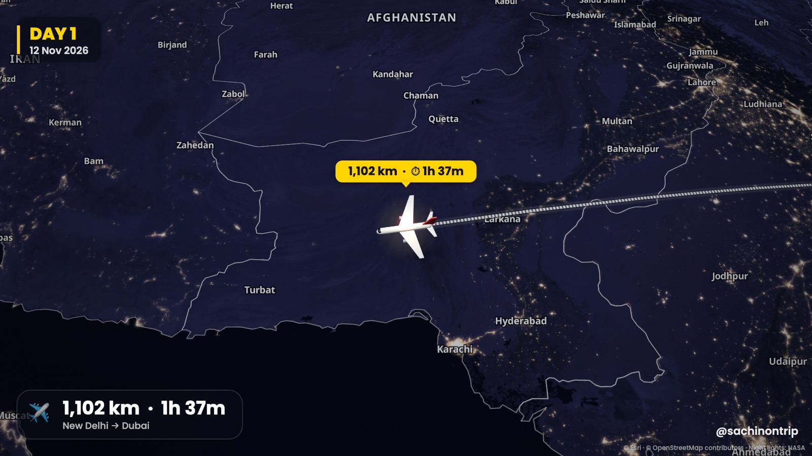
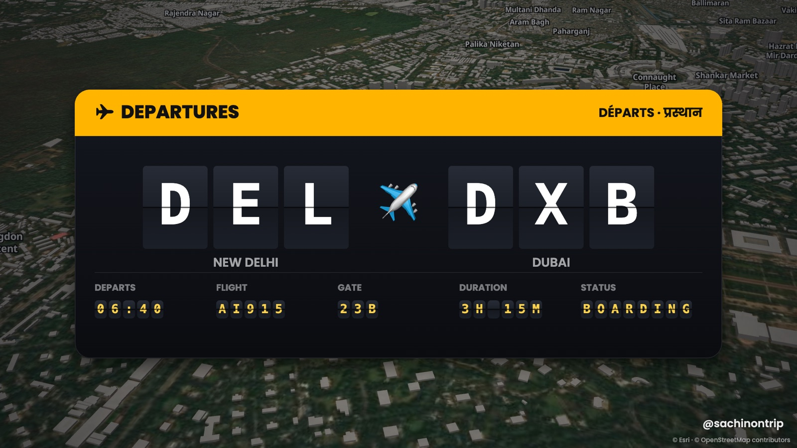
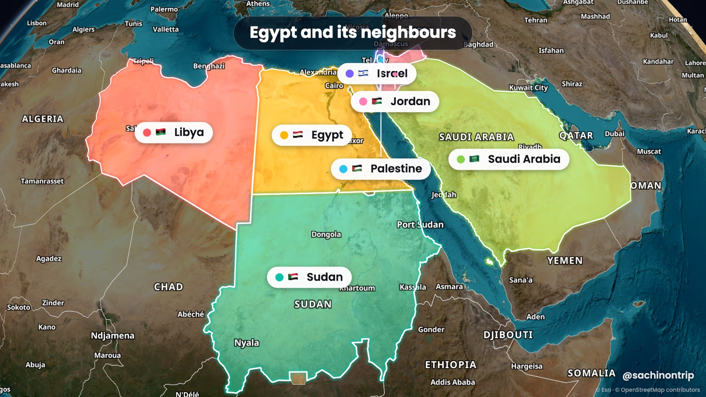
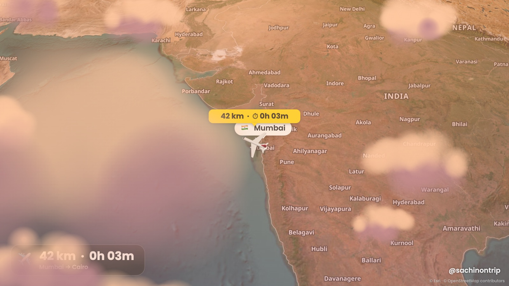

<div align="center">

# ✈️ Map My Trip

**Free travel map animation maker for YouTube videos and Instagram Reels.**
Animated flight paths on a 3D globe, road trips, train and walking routes, countries lighting up one by one, airport departure boards and night-time city lights. Exported to MP4, right in your browser.

[**▶ Try it live**](https://sachinontrip.github.io/map-my-trip/) · [Download](../../archive/refs/heads/main.zip) · [Features](#-features) · [How to use](#-run-it-on-your-computer)



</div>

No account, no watermark you can't change, no subscription. A free, open-source alternative to paid travel map animation apps.

## ✨ Features

| | |
|---|---|
|  |  |
| **🛫 Departure board intro.** A split-flap airport board ("DEL ✈ DXB · 3H 15M · BOARDING") with real airport codes, filled in automatically. | **🎨 Country highlights.** Countries, Indian states or any city light up one by one in their own colour, and the camera flies to each one. |
|  | **🌅 Time of day.** Pick day, morning, sunset or night for each trip. The plane climbs through clouds after take-off and drops through them before landing.<br><br>**🌙 Night city lights.** Real NASA night-time imagery from high up (see the top image), glowing streets up close and a blinking plane. |

**Every way you travel**
- ✈️ **Flight path animation** along a great-circle arc on a 3D globe, with a real 3D airliner that banks into turns
- 🚕 🚗 🚌 🚆 🚲 ⛴️ 🚶 **Taxi, car, bus, train, bike, boat and walking routes** that follow real roads and footpaths
- 📍 **3D landmark close-ups** that orbit around a place, with a pin drop and a title card

**Made for travel vloggers**
- 📏 **Live distance counter** in a yellow tag above the vehicle (850 m → 3.4 km → 4,429 km), plus the **flight time** counting up beside it
- 📅 **Day and date badge** ("DAY 2 · 13 Nov") that flips as your trip moves on
- 🖼️ **Photo and video pop-ups** when you arrive somewhere
- 🔊 **Sound effects generated in code**: jet roar, engine hum, train clacks, footsteps, counter ticks, whooshes and an arrival ding
- ✍️ **Type your trip**: write *"Delhi to Cairo by flight, taxi to the pyramids, show Egypt's neighbours"* and the scenes are built for you (English or Hinglish)

**Export**
- 🎬 **MP4 in 720p, 1080p, 1440p or 4K**, at 30 or 60 fps, with sound
- 📱 **16:9 for YouTube, 9:16 for Reels and Shorts**, plus 1:1 and 4:5
- 🟩 **Green screen MP4** for CapCut, VN and InShot, or a **transparent PNG sequence** for Premiere Pro, DaVinci Resolve and Final Cut
- 🗺️ **9 map styles**: satellite, satellite with names, cinematic dark, 3D streets, bright, voyager, minimal light and dark, vintage paper

**Comfortable to work in**: undo and redo, drag-and-drop scenes, keyboard shortcuts, 0.5× to 2× preview speed, and project files you can share with your editor.

## 🚀 Run it on your computer

You need [Node.js](https://nodejs.org) (the free "LTS" version) and Chrome or Edge.

```bash
git clone https://github.com/sachinontrip/map-my-trip.git
cd map-my-trip
npm start
```

Then open **http://localhost:5199**.

No terminal? [Download the ZIP](../../archive/refs/heads/main.zip), unzip it, and double-click:
- **Mac:** `Start Map My Trip.command` (the first time: right-click it and choose Open)
- **Windows:** `Start Map My Trip (Windows).bat` (if you see "Windows protected your PC", click More info, then Run anyway)

There's nothing to `npm install`: every library is already in `vendor/`.

## 🎥 Make your first video in 1 minute

1. Click **✨ Type your trip** and write your route, or add scenes with **Travel**, **Countries** and **Spotlight**.
2. Pick a map look, the **format** (16:9 or 9:16) and the quality.
3. Press **Space** to preview with sound.
4. Click **⬇ Export video**.

**Tips**
- Set each scene's length to match your voiceover line, so countries light up as you name them.
- Press **?** to see every keyboard shortcut.
- **Save** downloads a `.mapmytrip.json` project file (photos included) that you can send to your editor.

## 🛠 How it works

It's a static web app with no build step and no backend: plain JavaScript modules, [MapLibre GL](https://maplibre.org) for the 3D globe and terrain, [three.js](https://threejs.org) for the plane, and WebCodecs with [mp4-muxer](https://github.com/Vanilagy/mp4-muxer) for the MP4 export. Every frame is a pure function of time, so the exported video matches the preview exactly. Each frame waits for every map tile to load, so exports stay sharp even on slow internet.

```
index.html        app shell
js/engine.js      timeline, camera moves and overlay drawing
js/looks.js       day / sunset / night looks and clouds
js/board.js       departure board
js/prompt.js      "Type your trip" parser
js/audio.js       generated sound effects
js/exporter.js    MP4 / PNG export
data/             country borders, Indian states, airports
```

## 🤝 Contributing

Ideas, bug reports and pull requests are welcome. Open an issue first if you're planning something big. A ⭐ helps other travel creators find the project.

## 📜 Credits and license

Code: [MIT](LICENSE). Made by **[@sachinontrip](https://www.youtube.com/@sachinontrip)** for travel vlogs.

Map data © [OpenStreetMap](https://www.openstreetmap.org/copyright) contributors, served by [OpenFreeMap](https://openfreemap.org) and [CARTO](https://carto.com). Satellite imagery © Esri, Maxar, Earthstar Geographics. Night lights from NASA Earth Observatory (Black Marble). Terrain from AWS Terrain Tiles. Borders from [Natural Earth](https://www.naturalearthdata.com) (India's point of view). Airports from [OurAirports](https://ourairports.com) (public domain). Search by [Photon](https://photon.komoot.io) and [Nominatim](https://nominatim.org), and routing by [OSRM](https://project-osrm.org). The map credits are drawn into every exported video.

<sub>Keywords: travel map animation, animated flight path, flight route animation, travel vlog map, map animation for YouTube, Instagram Reels map animation, animated route map, 3D globe animation, road trip map video, free travel map maker</sub>
